

  

    <strong>Topology:</strong> Single-Stage NMOS-Input Differential Pair with PMOS Current-Mirror Active Load (<code>M1–M5</code>) 
    <strong>EDA Tooling:</strong> Cadence Virtuoso Schematic &amp; Analog Design Environment (DC, AC, Noise, Transient) 
    <strong>Device Geometry &amp; Supply:</strong> <i>W</i> = 2 &mu;m, <i>L</i> = 0.35 &mu;m (all devices) &nbsp;|&nbsp; <i>V</i>DD = 3.3 V, <i>V</i>CM = 1.65 V, <i>V</i>b = 0.90 V, <i>C</i>L = 10 pF 
    <strong>Verification Suite:</strong> Operating-Point (DC), Small-Signal Frequency Response (AC), Input/Output Noise, Large-Signal Transient, CMRR, and PSRR+ 
    <strong>Design Targets:</strong> GBW &gt; 3 MHz (@ 10 pF), Input White Noise &lt; 100 nV/&radic;Hz, Output Swing &gt; 1.5 Vpp
  

---

## Executive Summary

Single-stage operational transconductance amplifiers (OTAs) serve as foundational front-end gain stages in capacitive sensor readout interfaces and mixed-signal instrumentation. This technical case study presents the complete analytical design, transistor-level biasing, and multi-domain simulation verification of a five-transistor CMOS differential amplifier in a 0.35 &mu;m process under a 3.3 V supply and 10 pF capacitive load.

Starting from first-principles small-signal and noise models, the tail bias current ($I_{SS} \approx 52\ \mu\text{A}$ at $V_b = 0.90\ \text{V}$) and input-pair transconductance ($g_{m1} \approx 210.3\ \mu\text{S}$) are sized to guarantee stable open-loop bandwidth margin while keeping all five devices firmly in saturation. Comprehensive DC, AC, noise, and large-signal transient simulations verify an open-loop DC gain of **26.92 dB** ($22.19\ \text{V/V}$), a unity-gain frequency of **3.176 MHz** with **92.52&deg;** phase margin, an input-referred white noise floor of **17.54 nV/&radic;Hz**, a **1.60 Vpp** large-signal output swing, a low-frequency **CMRR of 57.65 dB**, and a **PSRR+ of 26.93 dB**. The final section summarizes the physical trade-offs and optimization levers of this short-channel single-stage topology.

### Specification Compliance Summary

| Performance Metric | Design Target | Analytical Estimate | Cadence Simulation |
| :--- | :--- | :--- | :--- |
| **Open-Loop DC Gain ($A_0$)** | — | $g_{m1}(r_{o2} \parallel r_{o4})$ | 26.92 dB (22.19 V/V) |
| **Gain-Bandwidth Product (GBW)** | &gt; 3 MHz (@ 10 pF) | 3.35 MHz | 3.176 MHz (0 dB cross) |
| **Phase Margin (PM)** | — | ~90&deg; (single-pole) | 92.52&deg; ($\angle = -87.48^\circ$) |
| **Input-Referred White Noise** | &lt; 100 nV/&radic;Hz | 12.4 nV/&radic;Hz (thermal) | 17.54 nV/&radic;Hz (@ 100 MHz) 79.69 nV/&radic;Hz (@ 1 MHz) |
| **Output Voltage Swing** | &gt; 1.5 Vpp | 0.917–2.862 V (1.945 V) | 1.25–2.85 V (1.60 Vpp) |
| **Common-Mode Rejection (CMRR)** | Characterized | 57.63 dB | 57.65 dB (DC/AC low-freq) |
| **Power-Supply Rejection (PSRR+)** | Characterized | 26.93 dB | 26.93 dB ($A_{vdd} \approx 0.9994$) |

---

## 1. Circuit Topology & Small-Signal Theory

### 1.1 Five-Transistor Differential-to-Single-Ended Architecture

The amplifier adopts an NMOS-input differential pair (`M1`, `M2`) loaded by a PMOS active current mirror (`M3`, `M4`) and biased by an NMOS tail current source (`M5`), as shown in Figure 1. When both inputs are held at the same common-mode voltage, the tail current splits equally between the two branches. When a differential voltage is applied, the branch currents steer in opposite directions, and the `M3`–`M4` mirror folds the `M1` current variation onto the single-ended output node `Vout`.

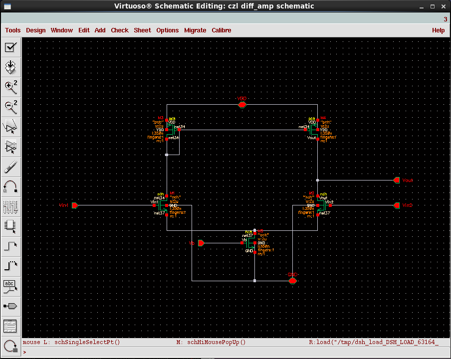
*Figure 1. Schematic of the single-stage CMOS differential amplifier (`M1`–`M5`, `W = 2 μm`, `L = 0.35 μm`).*

### 1.2 Tail Current Source (`M5`)

Transistor `M5` has both its source and bulk tied to `GND`, its gate driven by the DC bias `Vb`, and its drain connected to the common-source node of `M1` and `M2`. In saturation—where $V_b > V_{TN5}$ and $V_{DS5} \ge V_{DSAT5}$—the drain current is relatively insensitive to drain-source voltage variations and establishes the tail current $I_{SS}$. Neglecting channel-length modulation, the square-law approximation gives:

$$I_{SS} \approx \frac{1}{2}\mu_n C_{ox}\left(\frac{W}{L}\right)_5 (V_b - V_{TN5})^2$$

Increasing `Vb` raises the gate-source overdrive voltage and increases $I_{SS}$, while finite output conductance $g_{ds5}$ introduces weak dependence on the common-source potential.

### 1.3 Differential Input Pair (`M1`, `M2`)

Decomposing the two input voltages into common-mode ($v_{CM}$) and differential ($v_{id} = v_1 - v_2$) components yields:

$$v_1 = v_{CM} + \frac{v_{id}}{2}, \qquad v_2 = v_{CM} - \frac{v_{id}}{2}$$

With matched input devices under zero differential input ($v_{id} = 0$), the tail current divides equally ($I_{D1} \approx I_{D2} \approx I_{SS}/2$). For small differential excursions where both transistors remain in saturation and the common-source node acts as a virtual AC ground:

$$\Delta i_1 \approx \frac{g_{m1}v_{id}}{2}, \qquad \Delta i_2 \approx -\frac{g_{m1}v_{id}}{2}$$

Thus, the differential pair linearly converts an input voltage difference into complementary branch currents; larger differential swings leave this linear regime and are evaluated via large-signal DC and transient sweeps.

### 1.4 Current-Mirror Active Load (`M3`, `M4`)

Diode-connected `M3` and output-branch `M4` share the same gate potential and have their sources tied to `VDD`, enforcing equal $V_{SG}$. Under matched process parameters and saturation without channel-length modulation, the mirrored current ratio tracks the aspect ratios:

$$\frac{I_4}{I_3} \approx \frac{(W/L)_4}{(W/L)_3}$$

Because `M3` and `M4` are identically sized (`W = 2 μm`, `L = 0.35 μm`), the mirror ratio is $1:1$. The `M1` current increment is mirrored into `M4` and combines constructively with the complementary decrement in `M2`. Defining positive output current as flowing into the output node:

$$\Delta i_o \approx \Delta i_1 - \Delta i_2 \approx g_{m1}v_{id}$$

### 1.5 Low-Frequency Gain and Gain-Bandwidth Product

At the output node (the shared drain of `M2` and `M4`), the small-signal output resistance is $R_o \approx r_{o2} \parallel r_{o4}$, producing a low-frequency differential voltage gain of:

$$A_0 \approx g_{m1}(r_{o2} \parallel r_{o4})$$

Assuming the capacitive load $C_L$ at the output forms the dominant pole and that internal mirror-node poles and device parasitics lie at much higher frequencies, the output impedance and open-loop transfer function become:

$$Z_o(s) = \frac{R_o}{1 + s R_o C_L}, \qquad A_v(s) \approx \frac{g_{m1}R_o}{1 + s R_o C_L} = \frac{A_0}{1 + s/\omega_p}$$

From this single-pole model, $A_0$ and the $-3\ \text{dB}$ corner frequency $f_{-3\text{dB}}$ satisfy:

$$A_0 \approx g_{m1}R_o, \qquad f_{-3\text{dB}} \approx \frac{1}{2\pi R_o C_L}$$

Multiplying the two cancels $R_o$, yielding the fundamental first-order GBW sizing equation:

$$\text{GBW} \approx \frac{g_{m1}}{2\pi C_L}$$

---

## 2. Bias Design & DC Operating-Point Verification

### 2.1 Hand Calculation of Bias Current

Substituting $C_L = 10\ \text{pF}$ and the target $\text{GBW} > 3\ \text{MHz}$ into the GBW relation requires $g_{m1} > 188.5\ \mu\text{S}$. To provide bandwidth margin against parasitic capacitances and non-dominant poles, the design targets $g_{m1} \approx 210\ \mu\text{S}$. Using the square-law transconductance identity:

$$g_m \approx \frac{2I_D}{V_{OV}}$$

Choosing an initial input-pair overdrive voltage $V_{OV} \approx 0.25\ \text{V}$ gives a single-branch quiescent current of $I_D \approx 26\ \mu\text{A}$ and a total target tail current of $I_{SS} \approx 52\ \mu\text{A}$.

### 2.2 Tail Bias DC Sweep

The supply is fixed at $V_{DD} = 3.3\ \text{V}$ with both inputs biased at mid-rail ($V_{CM} = 1.65\ \text{V}$) to preserve headroom for both the input pair and tail current source, and a $10\ \text{pF}$ load capacitor is attached from `Vout` to `GND`. All five transistors (`M1`–`M5`) adopt $W = 2\ \mu\text{m}$ and $L = 0.35\ \mu\text{m}$ to satisfy the bandwidth and thermal noise budgets while maintaining compact area. Sweeping the tail gate bias $V_b$ from $0.55\ \text{V}$ to $1.05\ \text{V}$ in $0.01\ \text{V}$ steps yields the tail current and quiescent output voltage curves in Figures 2 and 3.

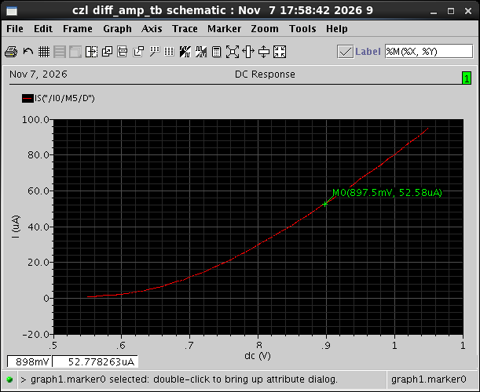
*Figure 2. `M5` drain current $I_{SS}$ versus tail gate bias voltage `Vb`.*

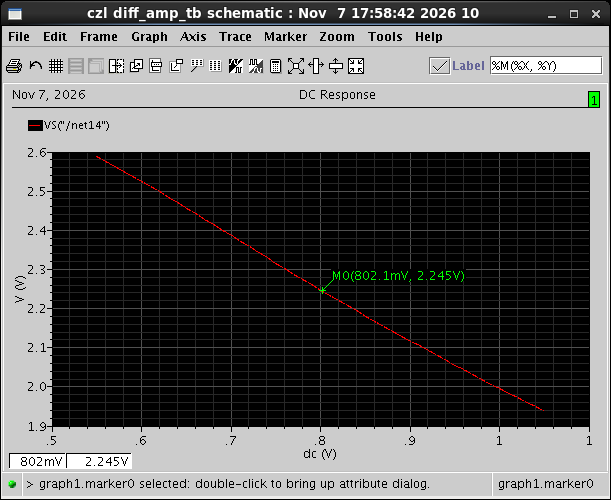
*Figure 3. Quiescent output node voltage versus tail gate bias voltage `Vb`.*

From Figure 2, $I_{SS}$ increases monotonically with `Vb`, reaching $52.58\ \mu\text{A}$ at $V_b \approx 0.898\ \text{V}$—closely matching the $52\ \mu\text{A}$ target. Consequently, **$V_b = 0.90\ \text{V}$** is selected as the nominal tail bias. At this operating point, Figure 3 shows a quiescent output voltage of approximately $2.12\ \text{V}$ (slightly above mid-rail $1.65\ \text{V}$).

### 2.3 Saturation Region Verification

At $V_b = 0.90\ \text{V}$ and $V_{CM} = 1.65\ \text{V}$ ($V_{id} = 0$), Table 1 consolidates the quiescent operating-point parameters extracted from Cadence for all five transistors (`M1`–`M5`), allowing direct verification of every small-signal formula used in Sections 4–7. The corresponding Cadence *Results Display Window* printouts are preserved in Figures 4–6 (with the PMOS saturation boundary view shown in Figure 12).

| Device | Role | $I_D$ ($\mu\text{A}$) | $g_m$ ($\mu\text{S}$) | $g_{mb}$ ($\mu\text{S}$) | $g_{ds}$ ($\mu\text{S}$) | $\lvert V_{DS} \rvert$ (V) | $\lvert V_{DSAT} \rvert$ (mV) | Region |
| :--- | :--- | :--- | :--- | :--- | :--- | :--- | :--- | :--- |
| **`M1`, `M2`** | NMOS input pair | $26.6$ | $210.3$ | $40.21$ | $4.36$ | $1.399$ | $198.4$ | `2` (Sat.) |
| **`M3`, `M4`** | PMOS active mirror | $26.6$ ($\lvert I_D \rvert$) | $97.5$ | $19.8$ | $4.88$ | $1.182$ | $438.4$ | `2` (Sat.) |
| **`M5`** | NMOS tail source | $53.2$ ($\lvert I_S \rvert$) | — | — | $7.34^\dagger$ | $0.7188$ | $271.6$ | `2` (Sat.) |

*Note: All five devices operate in saturation (`region = 2`) with $\lvert V_{DS} \rvert > \lvert V_{DSAT} \rvert$. For `M5`, Figure 6 is scrolled to the voltage/region parameters (`vds = 718.8 mV`, `vdsat = 271.6 mV`, `ron = 13.51 kΩ`); the small-signal output conductance $g_5 = 7.34\ \mu\text{S}$ ($\dagger$) is read from the upper portion of the same `M5` DC operating-point printout.*

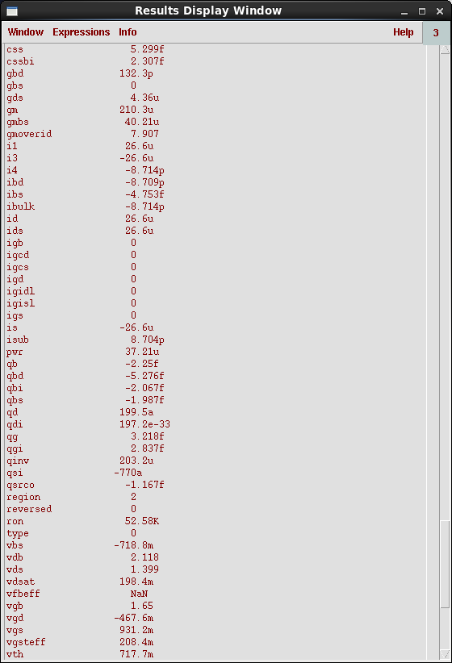
*Figure 4. Quiescent operating-point parameters for input pair `M1`/`M2`.*

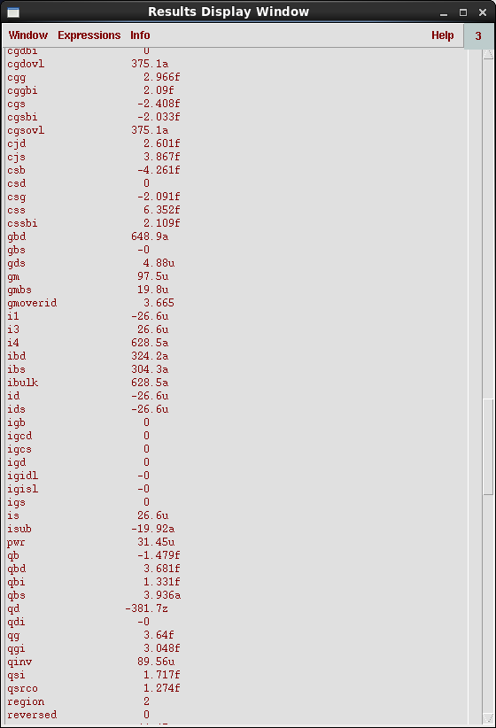
*Figure 5. Quiescent operating-point parameters for current-mirror load (`M3`, mirrored to `M4`).*

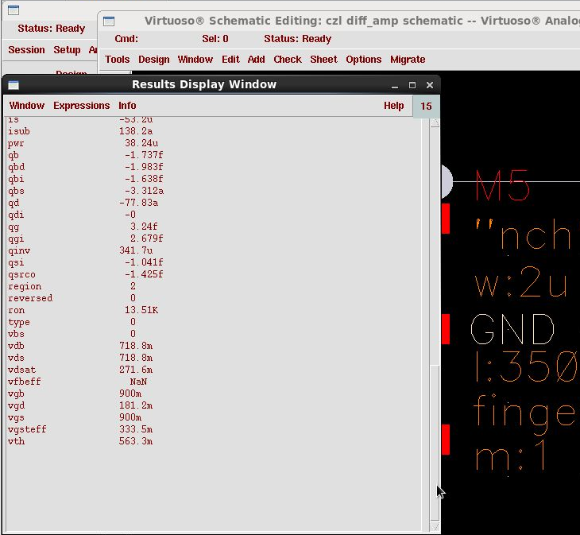
*Figure 6. Quiescent operating-point voltage and saturation parameters for tail current source `M5`.*

From Figure 4, `M1`/`M2` exhibit $V_{bs} = -718.8\ \text{mV}$ (fixing the common-source potential at $V_S \approx 0.719\ \text{V}$) and $V_{db} = 2.118\ \text{V}$, providing comfortable headroom above $V_{DSAT}$ across all five devices.

---

## 3. Differential AC Gain & Frequency Response

To apply independent common-mode and differential excitations cleanly, the `diff_amp` cell is encapsulated as a six-pin symbol and embedded in the open-loop testbench shown in Figure 7. Note that the diode connection on `M3` is strictly internal to the current mirror; no external feedback path exists between `Vout` and the inputs, so all AC and CMRR measurements reflect true open-loop behavior.

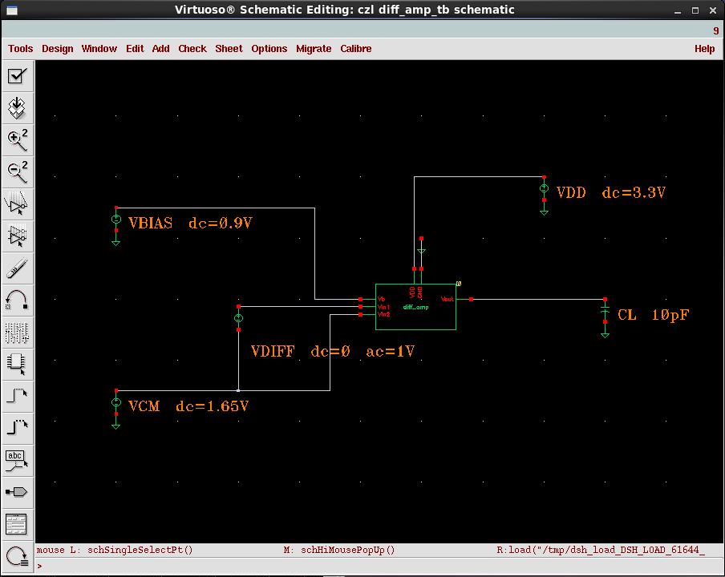
*Figure 7. Open-loop testbench schematic for differential DC, AC, noise, and transient verification.*

In this testbench, `VDD = 3.3 V`, `VBIAS = 0.90 V`, `VCM = 1.65 V`, and `CL = 10 pF`. A series source `VDIFF` (`dc = 0`, `ac = 1 V`) is placed between `VCM` and `Vin1` while `Vin2` connects directly to `VCM`, establishing identical DC bias on both inputs alongside a $1\ \text{V}$ AC differential stimulus.

Sweeping `VDIFF` from $-0.5\ \text{V}$ to $+0.5\ \text{V}$ produces the DC transfer characteristic in Figure 8, showing steep linear gain around zero differential input and smooth compression near the supply rails.

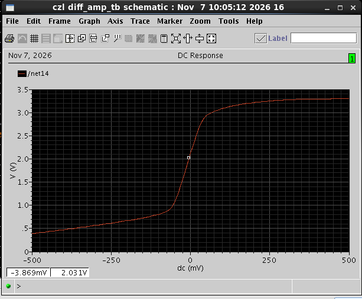
*Figure 8. Output voltage versus differential DC input sweep from $-0.5\ \text{V}$ to $+0.5\ \text{V}$.*

Substituting $s = j2\pi f$ into the single-pole transfer function yields the magnitude response:

$$|A_v(f)| \approx \frac{A_0}{\sqrt{1 + \left(\frac{f}{f_{-3\text{dB}}}\right)^2}}$$

Figure 9 plots the simulated open-loop magnitude (top, white) and unwrapped phase (bottom, red) from $1\ \text{Hz}$ to $100\ \text{MHz}$.

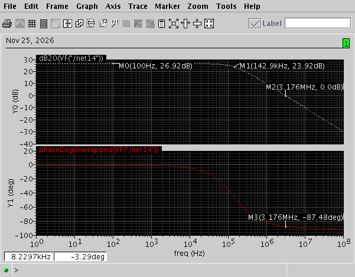
*Figure 9. Open-loop differential AC magnitude (`dB20`) and unwrapped phase response from $1\ \text{Hz}$ to $100\ \text{MHz}$.*

Key extracted AC metrics from Figure 9:
- **Low-frequency differential gain ($100\ \text{Hz}$)**: $26.92\ \text{dB}$ ($22.19\ \text{V/V}$).
- **$-3\ \text{dB}$ corner frequency ($f_{-3\text{dB}}$)**: $142.9\ \text{kHz}$ ($23.92\ \text{dB}$).
- **Estimated $A_0 \times f_{-3\text{dB}}$ product**: $22.19 \times 142.9\ \text{kHz} \approx 3.17\ \text{MHz}$.
- **Measured $0\ \text{dB}$ unity-gain frequency**: **$3.176\ \text{MHz}$**, exceeding the $3\ \text{MHz}$ requirement.
- **Phase at unity gain**: $-87.48^\circ$, corresponding to a generous **$92.52^\circ$ phase margin**.

The measured $3.176\ \text{MHz}$ GBW is slightly below the $3.35\ \text{MHz}$ first-order hand calculation ($210.3\ \mu\text{S} / (2\pi \cdot 10\ \text{pF})$). Accounting for total output capacitance $C_\Sigma = C_L + C_{par}$ (drain-bulk and interconnect parasitics) and internal mirror-pole effects explains this slight reduction:

$$C_\Sigma = C_L + C_{par}, \qquad f_p \approx \frac{1}{2\pi R_o C_\Sigma}, \qquad \text{GBW} \approx \frac{g_{m1}}{2\pi C_\Sigma}$$

---

## 4. Input- and Output-Referred Noise Analysis

### 4.1 Thermal and Flicker ($1/f$) Noise Modeling

Input-referred noise voltage spectral density normalizes output noise by the amplifier's frequency-dependent voltage gain:

$$e_{n,in}(f) = \frac{e_{n,out}(f)}{|A_v(f)|}$$

In saturation, each MOSFET exhibits a channel thermal noise current spectral density:

$$S_{i,th} \approx 4 k T \gamma g_m$$

Treating the channel thermal noise of `M1`–`M4` as uncorrelated and assuming $1:1$ mirroring and matched pairs, the four noise powers sum at the output and refer back to the differential input through $g_{m1}$:

$$e_{n,th}^2 \approx \frac{8 k T \gamma (g_{m1} + g_{m3})}{g_{m1}^2}$$

Using the simulated operating-point transconductances ($g_{m1} = 210.3\ \mu\text{S}$, $g_{m3} = 97.5\ \mu\text{S}$), $T = 300.15\ \text{K}$, and $\gamma = 2/3$, the analytical thermal noise floor is approximately **$12.4\ \text{nV}/\sqrt{\text{Hz}}$**.

When flicker ($1/f$) noise is included alongside white thermal noise ($e_w$), the total input-referred noise density follows:

$$S_{1/f}(f) \approx \frac{K}{f^\alpha}, \qquad e_n(f) \approx \sqrt{e_w^2 + \frac{K}{f^\alpha}}$$

At low frequencies, the $1/f$ term dominates because of the small gate area ($W \cdot L = 0.7\ \mu\text{m}^2$), pushing the flicker corner frequency higher; as frequency increases, the $1/f$ contribution rolls off and converges toward the white noise floor.

### 4.2 Noise Simulation Results

Performing a logarithmic noise sweep from $1\ \text{Hz}$ to $100\ \text{MHz}$ (40 points/decade) with `Vout` as output and `VDIFF` as input reference yields the spectra in Figures 10 and 11.

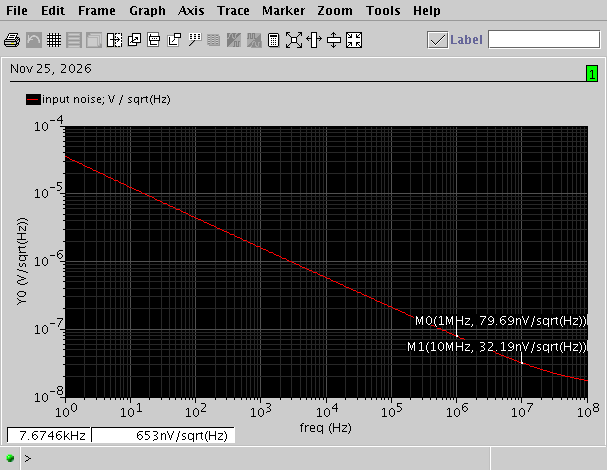
*Figure 10. Input-referred noise voltage spectral density from $1\ \text{Hz}$ to $100\ \text{MHz}$.*

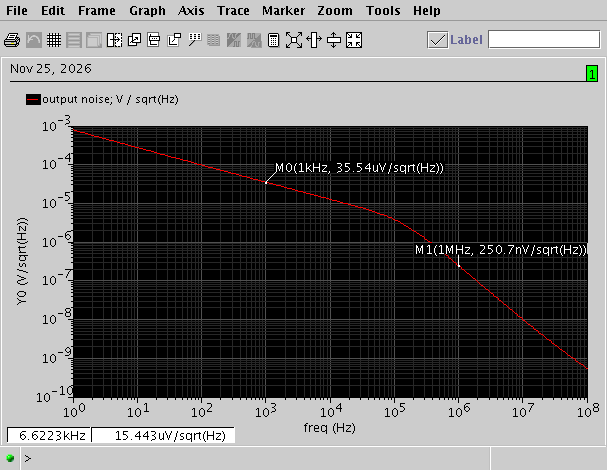
*Figure 11. Output noise voltage spectral density from $1\ \text{Hz}$ to $100\ \text{MHz}$.*

In Figure 10, the input-referred noise drops to **$79.69\ \text{nV}/\sqrt{\text{Hz}}$** at $1\ \text{MHz}$, **$32.19\ \text{nV}/\sqrt{\text{Hz}}$** at $10\ \text{MHz}$, and approaches the white-noise plateau of **$17.54\ \text{nV}/\sqrt{\text{Hz}}$** at $100\ \text{MHz}$. The slight offset above the $12.4\ \text{nV}/\sqrt{\text{Hz}}$ hand estimate arises from parasitic gate/substrate resistive noise and short-channel excess noise factor ($\gamma > 2/3$). Under the white-noise specification criterion, $17.54\ \text{nV}/\sqrt{\text{Hz}}$ is well below the $100\ \text{nV}/\sqrt{\text{Hz}}$ ceiling. In Figure 11, output noise measures $35.54\ \mu\text{V}/\sqrt{\text{Hz}}$ at $1\ \text{kHz}$ (consistent with $1.60\ \mu\text{V}/\sqrt{\text{Hz}} \times 22.19$) and rolls off steeply beyond the $142.9\ \text{kHz}$ dominant pole to $250.7\ \text{nV}/\sqrt{\text{Hz}}$ at $1\ \text{MHz}$.

---

## 5. Output Swing Estimation & Large-Signal Transient Verification

### 5.1 Analytical Saturation Boundaries

Keeping both output devices (`M2` and `M4`) in saturation constrains the output voltage between:

$$V_{out,\min} \approx V_S + V_{DSAT2}, \qquad V_{out,\max} \approx V_{DD} - |V_{DSAT4}|$$

From Figure 4 (`M2`), $V_S \approx 0.719\ \text{V}$ and $V_{DSAT2} = 198.4\ \text{mV}$; from Figure 12 (`M4`), $V_{DSAT4} = -438.4\ \text{mV}$.

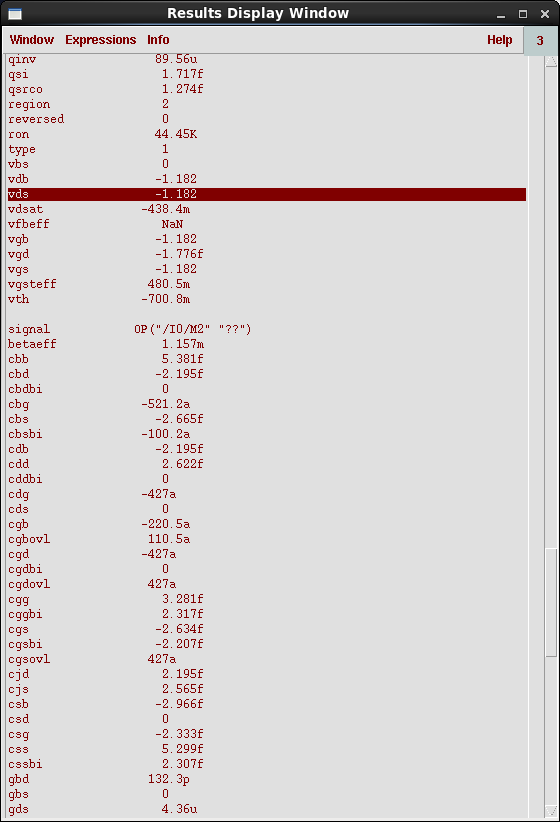
*Figure 12. Operating-point saturation parameters for active load transistor `M4`.*

Substituting these values predicts a linear saturation window of **$0.917\ \text{V}$ to $2.862\ \text{V}$**, corresponding to a theoretical range of **$1.945\ \text{V}$**. Because $V_S$, branch currents, and $V_{DSAT}$ shift dynamically during large excursions, this static estimate is cross-checked via DC and transient simulations.

### 5.2 Fine Differential DC Sweep & 1 kHz Transient Waveform

Figure 13 zooms into the differential DC transfer curve over $[-0.30\ \text{V}, +0.30\ \text{V}]$, confirming the steep linear transition around $0\ \text{V}$ and saturation compression outside the linear window.

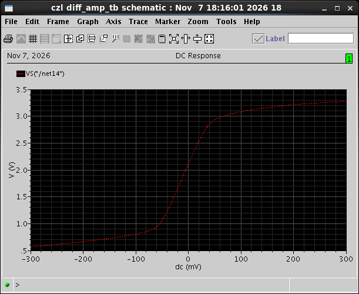
*Figure 13. Differential DC transfer characteristic over $-0.30\ \text{V}$ to $+0.30\ \text{V}$.*

Applying a $1\ \text{kHz}$, $40\ \text{mV}$-amplitude ($80\ \text{mV}_{pp}$) sinusoidal differential input produces the steady-state transient output waveform in Figure 14.

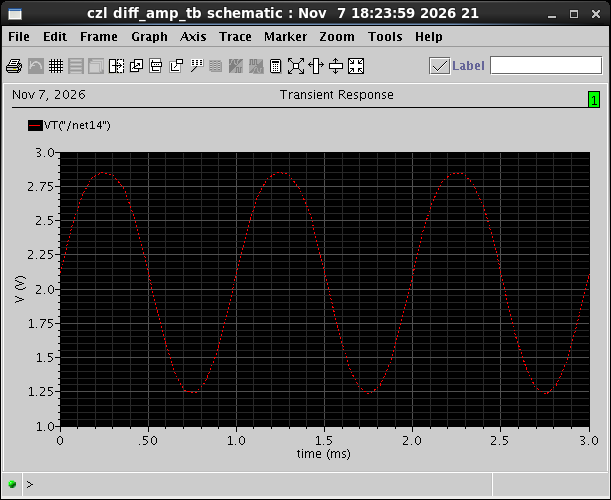
*Figure 14. Steady-state transient output response to a $1\ \text{kHz}$, $40\ \text{mV}$-peak sinusoidal differential input.*

The output swings between **$1.25\ \text{V}$ and $2.85\ \text{V}$**, achieving a peak-to-peak swing of **$1.60\ \text{V}_{pp}$** and satisfying the $>1.5\ \text{V}$ requirement. Subtle flattening at the positive peak near $2.85\ \text{V}$ aligns closely with the predicted $2.862\ \text{V}$ upper saturation boundary (`M4` triode onset) because the $2.118\ \text{V}$ quiescent level sits above mid-rail. Reducing input amplitude or re-centering the quiescent output toward $1.65\ \text{V}$ can further reduce peak distortion if higher linearity is required.

---

## 6. Common-Mode Rejection Ratio (CMRR)

### 6.1 Small-Signal Common-Mode Gain Derivation

Ideally, common-mode input variations cancel through the symmetric differential pair and `1:1` current mirror. In practice, finite tail output conductance $g_5$ and finite transistor output conductances allow common-mode leakage to the output:

$$A_{cm} = \frac{v_o}{v_{cm}}, \qquad A_d = \frac{v_o}{v_{id}}, \qquad \text{CMRR} = \frac{|A_d|}{|A_{cm}|}$$

Denoting the input-pair parameters as $g_m$, $g_{mb}$, and $g_n$; the PMOS mirror parameters as $g_{mp}$ and $g_p$; the tail conductance as $g_5$; the diode-connected mirror node voltage as $v_x$; and the common-source voltage as $v_s$, low-frequency symmetry yields $v_o \approx v_x$. Writing KCL at nodes $v_x$ and $v_s$ gives:

$$(g_n + g_p + g_{mp})v_x + g_m v_{cm} - (g_m + g_{mb} + g_n)v_s = 0$$

$$\bigl[2(g_m + g_{mb} + g_n) + g_5\bigr]v_s - 2g_n v_x = 2g_m v_{cm}$$

Eliminating $v_s$ and substituting $v_o \approx v_x$ yields the low-frequency common-mode gain:

$$A_{cm} \approx \frac{-g_m g_5}{(g_n + g_p + g_{mp})g_5 + 2(g_m + g_{mb} + g_n)(g_p + g_{mp})}$$

Substituting the extracted operating-point parameters ($g_m = 210.3\ \mu\text{S}$, $g_{mb} = 40.21\ \mu\text{S}$, $g_n = 4.36\ \mu\text{S}$, $g_{mp} = 97.5\ \mu\text{S}$, $g_p = 4.88\ \mu\text{S}$, $g_5 = 7.34\ \mu\text{S}$) yields $A_{cm} \approx -0.02914$. Combined with $A_d \approx 22.19$, the analytical CMRR estimate is:

$$\text{CMRR}_{est} \approx \frac{22.19}{0.02914} \approx 761.5 \quad \Longrightarrow \quad \text{CMRR}_{est,\text{dB}} = 20\log_{10}(761.5) \approx 57.63\ \text{dB}$$

### 6.2 Common-Mode DC and AC Verification

Sweeping $V_{CM}$ from $0\ \text{V}$ to $3.3\ \text{V}$ with $V_{DIFF} = 0$ produces the output voltage and derivative curves in Figure 15. At $V_{CM} = 1.65\ \text{V}$, the output is $2.118\ \text{V}$ with a local slope of **$-0.02906$**, confirming the small-signal prediction.

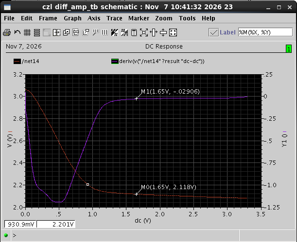
*Figure 15. Output voltage and its derivative ($\partial V_{out}/\partial V_{CM}$) across a $0\text{–}3.3\ \text{V}$ common-mode DC sweep.*

Setting `VCM` AC amplitude to $1\ \text{V}$ and `VDIFF` AC amplitude to $0$ yields the common-mode AC response in Figure 16. At low frequencies, $\lvert A_{cm} \rvert$ measures $-30.73\ \text{dB}$ ($0.02908\ \text{V/V}$), giving:

$$\text{CMRR}_{sim} = \frac{22.19}{0.02908} \approx 763.1 \quad \Longrightarrow \quad \text{CMRR}_{sim,\text{dB}} \approx 57.65\ \text{dB}$$

Dividing the differential and common-mode AC spectra point-by-point from $1\ \text{Hz}$ to $100\ \text{MHz}$ yields the frequency-dependent CMRR curve in Figure 17. Because the single dominant output pole limits both $\lvert A_d \rvert$ and $\lvert A_{cm} \rvert$ identically in mid-band, CMRR stays flat at **$57.65\ \text{dB}$** up to $10\ \text{MHz}$, before rolling off modestly to $54.3\ \text{dB}$ near $100\ \text{MHz}$ due to internal mirror-node and parasitic poles.

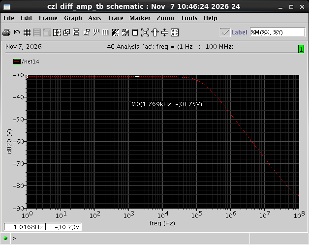
*Figure 16. Common-mode AC output magnitude response from $1\ \text{Hz}$ to $100\ \text{MHz}$.*

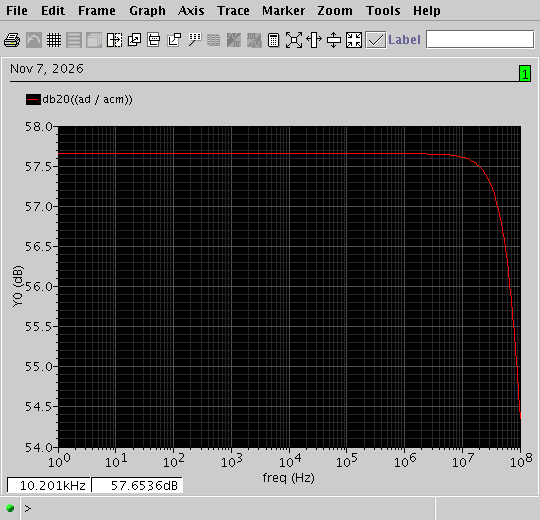
*Figure 17. Simulated CMRR ($\text{dB20}(\lvert A_d / A_{cm} \rvert)$) across frequency.*

---

## 7. Power-Supply Rejection Ratio (PSRR+)

### 7.1 Positive Supply Coupling Model

Because `M3` and `M4` have their sources tied directly to `VDD`, positive-rail ripple couples into the output node even when the differential inputs and `Vb` are held at fixed reference voltages. Defining the supply-to-output transfer gain $A_{vdd} = v_o/v_{dd}$:

$$\text{PSRR}_+ = \frac{|A_d|}{|A_{vdd}|}, \qquad \text{PSRR}_{+,\text{dB}} = 20\log_{10}(\text{PSRR}_+)$$

Letting $H = g_m + g_{mb} + g_n$ and applying small-signal KCL at nodes $v_x$ and $v_s$ with $v_{in1} = v_{in2} = v_b = 0$:

$$(g_n + g_p + g_{mp})v_x - H v_s = (g_p + g_{mp})v_{dd}, \qquad (2H + g_5)v_s = 2g_n v_x$$

Solving for $v_o \approx v_x$ gives:

$$A_{vdd} \approx \frac{g_p + g_{mp}}{g_p + g_{mp} + \dfrac{g_n g_5}{2H + g_5}}$$

Because the denominator term $\frac{g_n g_5}{2H + g_5} \approx 0.062\ \mu\text{S}$ is three orders of magnitude smaller than $g_p + g_{mp} = 102.38\ \mu\text{S}$, low-frequency positive-supply disturbances pass almost unattenuated to the output ($A_{vdd} \approx 0.9994$), yielding an estimated $\text{PSRR}_+ \approx 26.93\ \text{dB}$.

### 7.2 Supply DC Sweep & AC PSRR+ Verification

Sweeping `VDD` from $3.1\ \text{V}$ to $3.6\ \text{V}$ with fixed $V_{CM} = 1.65\ \text{V}$ and $V_b = 0.90\ \text{V}$ produces Figure 18. Across $3.29\ \text{V}$ to $3.31\ \text{V}$, the output rises from $2.107627\ \text{V}$ to $2.127615\ \text{V}$:

$$A_{vdd,\text{DC}} \approx \frac{2.127615 - 2.107627}{3.31 - 3.29} \approx 0.9994$$

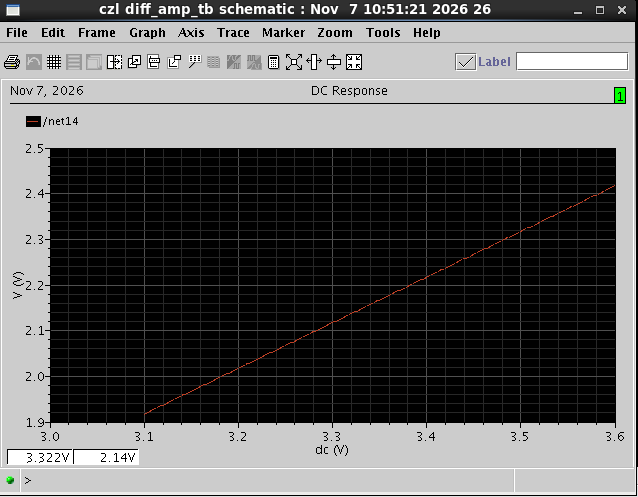
*Figure 18. Output voltage versus positive supply `VDD` sweep from $3.1\ \text{V}$ to $3.6\ \text{V}$ (fixed input/bias references).*

Applying a $1\ \text{V}$ AC perturbation to `VDD` (with input and bias AC amplitudes set to zero) yields $\lvert A_{vdd}(f) \rvert$ in Figure 19, confirming $\lvert A_{vdd} \rvert \approx 0.9994$ ($-0.005\ \text{dB}$) at low frequencies and rolling off past the output pole. Taking the ratio against the differential AC response produces Figure 20, showing **$\text{PSRR}_+ \approx 26.93\ \text{dB}$** from $1\ \text{Hz}$ to $10\ \text{MHz}$, with a slight dip to $26.23\ \text{dB}$ at $100\ \text{MHz}$.

$$\text{PSRR}_+ \approx \frac{22.19}{0.9994} \approx 22.20 \quad \Longrightarrow \quad \text{PSRR}_{+,\text{dB}} \approx 26.93\ \text{dB}$$

*(Note: Under single-supply operation where the negative rail serves as the circuit reference ground, only positive-rail `PSRR+` under fixed external bias references is evaluated here.)*

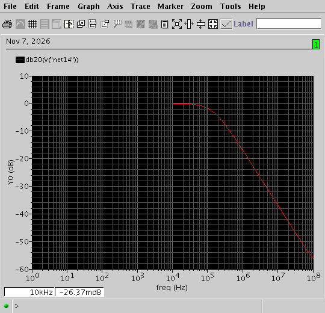
*Figure 19. Supply-to-output AC transfer magnitude $\lvert A_{vdd}(f) \rvert$ under fixed external references.*

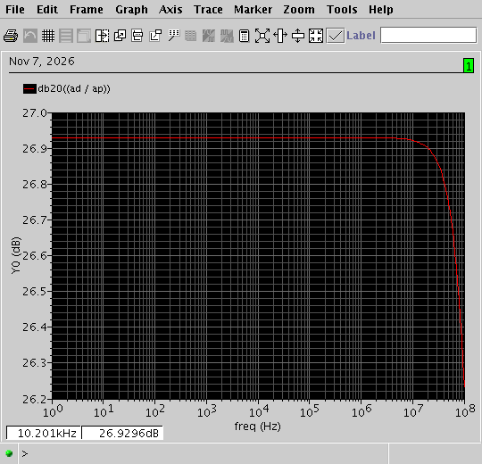
*Figure 20. Simulated positive power-supply rejection ratio ($\text{PSRR}_+$) across frequency.*

---

## 8. Performance Summary & Architectural Trade-Offs

Across DC, AC, noise, and large-signal transient simulations under $V_{DD} = 3.3\ \text{V}$, $V_{CM} = 1.65\ \text{V}$, $V_b = 0.90\ \text{V}$, and $C_L = 10\ \text{pF}$, all five devices ($W = 2\ \mu\text{m}$, $L = 0.35\ \mu\text{m}$) remain reliably in saturation and meet every design target while revealing clear architectural trade-offs:

1. **Bandwidth & Single-Pole Stability**: The amplifier achieves a $3.176\ \text{MHz}$ unity-gain frequency ($>3\ \text{MHz}$ target) with a $92.52^\circ$ phase margin. Because the single-stage architecture places only one dominant pole at the output node prior to unity gain, stability is guaranteed without Miller compensation.
2. **Noise Partitioning ($1/f$ vs. Thermal Floor)**: High-frequency input-referred noise converges to $17.54\ \text{nV}/\sqrt{\text{Hz}}$ ($79.69\ \text{nV}/\sqrt{\text{Hz}}$ at $1\ \text{MHz}$), comfortably satisfying the $<100\ \text{nV}/\sqrt{\text{Hz}}$ white-noise criterion and aligning within the same order of magnitude as the $12.4\ \text{nV}/\sqrt{\text{Hz}}$ channel-thermal estimate. The compact $0.7\ \mu\text{m}^2$ gate area increases low-frequency $1/f$ noise; increasing input-pair gate area $W \cdot L$ is the direct lever to push the flicker corner lower.
3. **Gain, Swing & Linearity**: The $0.35\ \mu\text{m}$ minimum channel length limits intrinsic output resistance ($r_{o2} \parallel r_{o4}$), capping open-loop DC gain at $26.92\ \text{dB}$ ($22.19\ \text{V/V}$). While the $1.60\ \text{V}_{pp}$ transient swing satisfies the $>1.5\ \text{V}$ target, mild peak compression appears near $2.85\ \text{V}$ because the $2.118\ \text{V}$ quiescent level sits above mid-rail. Scaling $W$ and $L$ proportionally (preserving $W/L$) or adopting a cascode/two-stage topology raises $r_o$ and open-loop gain at the expense of voltage headroom or compensation complexity.
4. **CMRR & PSRR+ Physical Limits**: Simulated low-frequency CMRR ($57.65\ \text{dB}$) and PSRR+ ($26.93\ \text{dB}$) match small-signal derivations to within $0.02\ \text{dB}$. Because fixed external bias references decouple `Vb` from `VDD` while `M3`/`M4` connect directly to `VDD`, positive-rail ripple propagates almost unattenuated ($A_{vdd} \approx 0.9994$); improving PSRR+ requires supply-independent current-mirror biasing or cascoding alongside higher differential gain.
