<div style="border-left: 3px solid #7e22ce; padding: 0.85rem 1.25rem; margin: 1.5rem 0; background: #faf5ff; border-radius: 0 4px 4px 0;">
  <div style="margin-bottom: 0.5rem;">
    <strong>Source Code:</strong>
    <a href="https://github.com/shuijingczl/stm32f4-ucosii-multisensor-system" target="_blank" style="color: #7e22ce; font-weight: 700; text-decoration: underline;">
      github.com/shuijingczl/stm32f4-ucosii-multisensor-system
    </a>
    <span style="color: #57606a;"> (Keil MDK-ARM / STM32CubeMX project &amp; μC/OS-II port)</span>
  </div>
  <div style="font-size: 0.96rem; line-height: 1.7; color: #334155;">
    <strong>Target Platform:</strong> STM32F407ZET6 (ARM Cortex-M4F @ 168 MHz, Hardware FPU)<br>
    <strong>RTOS Kernel:</strong> Preemptive μC/OS-II (1 ms SysTick, 7 Tasks, Mailboxes &amp; Semaphores)<br>
    <strong>Peripherals &amp; Buses:</strong> FSMC 16-bit TFT-LCD, SPI1 W25Q128 Flash, I2C1 AT24C02, 1-Wire DHT11, 10 kHz PWM, 115200 bps UART
  </div>
</div>

---

## Executive Summary

Modern precision instrumentation requires deterministic real-time responsiveness across heterogeneous sensor buses, actuators, non-volatile storage, and human-machine interfaces (HMI). A conventional bare-metal super-loop (`while(1)`) suffers from severe timing jitter when blocking I/O operations—such as 20 ms 1-Wire sensor handshakes, 5 ms EEPROM write cycles, or multi-millisecond LCD framebuffer writes—stall time-critical control loops.

This project presents the complete hardware-software co-design and RTOS refactoring of a **multi-sensor environmental monitoring and closed-loop control system** built on the **STM32F407ZET6** microcontroller and ported to the preemptive **μC/OS-II** real-time kernel. By decoupling acquisition, control, storage, UI rendering, and telemetry into orthogonal tasks synchronized via message mailboxes, binary semaphores, and microsecond-level data snapshots, the system guarantees hard real-time actuation while maintaining zero-flicker graphical visualization and power-loss data persistence.

---

## 1. System Hardware Architecture

The system is centered on an **STM32F407ZET6** (ARM Cortex-M4F, 168 MHz core clock, single-precision hardware FPU, 192 KB SRAM, 512 KB Flash) hosted on a Spark STM32F407 development board. All peripheral buses and timer channels are strictly decoupled to prevent pin or DMA contention.

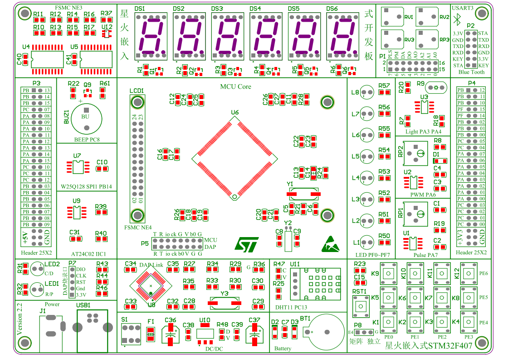
*Figure 1. Hardware layout and peripheral resource distribution of the STM32F407ZET6 platform.*

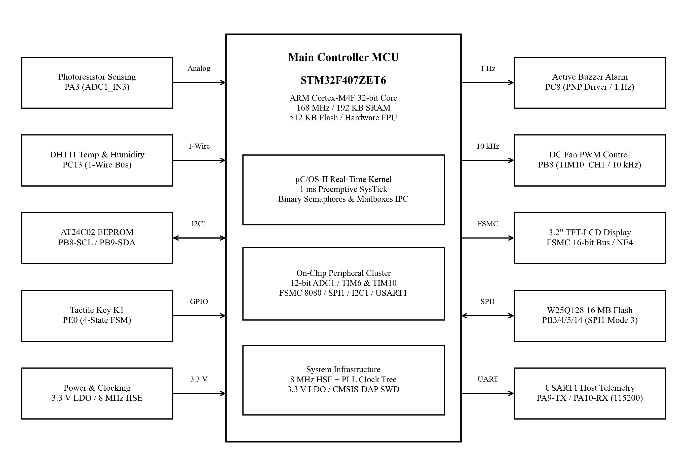
*Figure 2. Overall system hardware architecture and bus topology.*

### Hardware Pinout & Bus Allocation

| Pin(s) | Peripheral / Mode | Connected Hardware | Electrical & Timing Characteristics |
| :--- | :--- | :--- | :--- |
| `PA3` | `ADC1_IN3` (Analog Input) | Photoresistor Divider (`LS1`) | 12-bit resolution, 0–3.3 V linear sampling |
| `PC8` | `GPIO_Output` (Push-Pull) | Active Buzzer (`BEEP`) | Active-low PNP transistor driver (`Q9`), 1 Hz toggle |
| `PB8` | `TIM10_CH1` (AF Push-Pull) | DC Cooling Fan (`FAN`) | 10 kHz hardware PWM speed regulation |
| `PF9`, `PF10` | `GPIO_Output` (Push-Pull) | Status LEDs (`LED0`, `LED1`) | Active-low indicators with 680 Ω current-limiting resistors |
| `PC13` | `GPIO_Output / Input` | `DHT11` Sensor | Bidirectional 1-Wire bus with 4.7 kΩ pull-up |
| `PB8`, `PB9` | `I2C1_SCL`, `I2C1_SDA` | `AT24C02` EEPROM | 400 kHz hardware I2C open-drain with 10 kΩ pull-ups |
| `PD0–1,4–5,8–10,14–15`, `PE7–15`, `PG12`, `PF12` | `FSMC` 16-bit 8080 Bus (`NE4`, `A6`) | 3.2" TFT-LCD (`ILI9341`) | Memory-mapped command/data interface at `0x6C00007E` |
| `PB3–5`, `PB14` | `SPI1` (`SCK`, `MISO`, `MOSI`, `CS`) | `W25Q128` 16 MB NOR Flash | 42 MHz APB2/2 clock, SPI Mode 3 (`CPOL=1, CPHA=1`) |
| `PE0` | `GPIO_Input` (Internal Pull-Up) | Tactile Key `K1` | Active-low input with 4-state FSM software debounce |
| `PA9`, `PA10` | `USART1_TX`, `USART1_RX` | CH340G USB-TTL Bridge | 115200 bps 8-N-1 telemetry link |

### Analog Front-End & Actuator Driver Circuits

1. **Photoresistor Voltage Divider & Active Buzzer Driver**: The photoresistor forms a resistive voltage divider between +3.3 V and GND fed into `PA3`. ADC1 operates in single-conversion right-aligned 12-bit mode:
   $$V = \frac{\text{ADC\_VAL}}{4095} \times 3.3\,\text{V}$$
   The buzzer is driven via a PNP transistor (`Q9`) whose base is tied to `PC8` through a current-limiting resistor: a logic low forward-biases `Q9` to sound the buzzer, while a logic high cuts off the emitter-collector path.

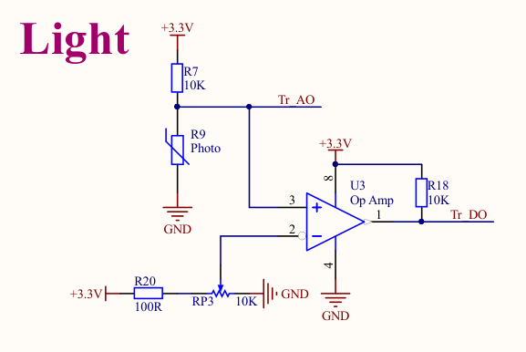
*Figure 3. Photoresistor resistive divider sensing circuit.*

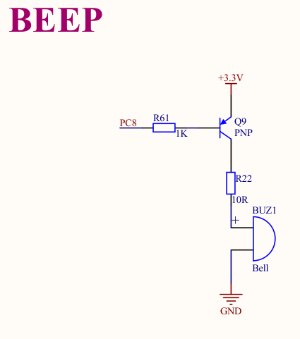
*Figure 4. PNP transistor switching driver for the active buzzer.*

2. **LED Indicators & Sensor Bus Interfaces**: On-board LEDs are wired in an active-low common-anode configuration via 680 Ω resistors. The DHT11 interfaces over a single-wire bidirectional line pulled up via 4.7 kΩ, while the AT24C02 (2 Kbit EEPROM, device addresses `0xA0`/`0xA1`) connects to hardware `I2C1`.

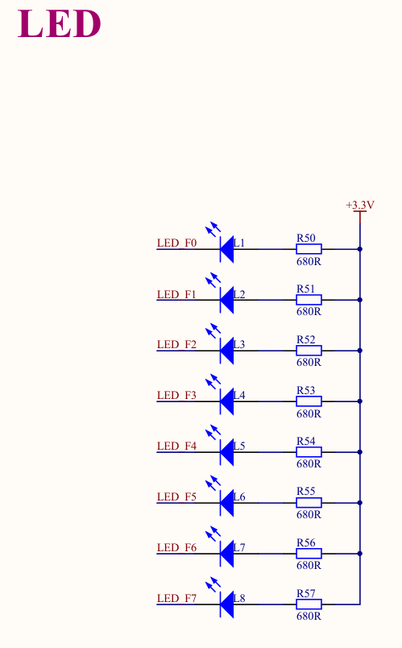
*Figure 5. Active-low LED indicator array.*

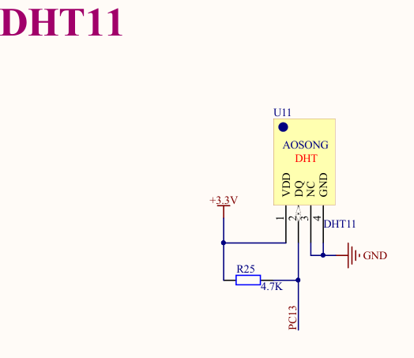
*Figure 6. DHT11 1-Wire digital temperature and humidity interface.*

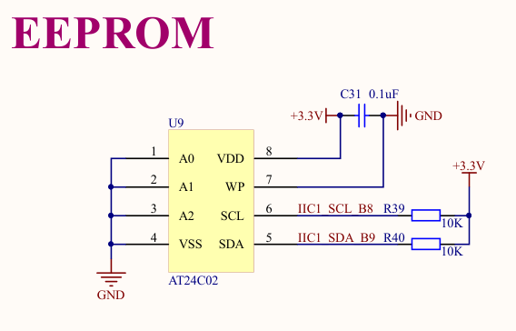
*Figure 7. AT24C02 hardware I2C serial EEPROM interface.*

3. **FSMC Parallel Display, SPI NOR Flash, and Key Input**: The 3.2-inch `ILI9341` TFT-LCD uses the STM32 Flexible Static Memory Controller (FSMC Bank1 NE4) for deterministic 16-bit memory-mapped writes. The `W25Q128` 128-Mbit NOR Flash (4096 sectors of 4 KB each) operates over `SPI1` at 42 MHz, and `K1` connects to `PE0` with a 10 kΩ pull-up.

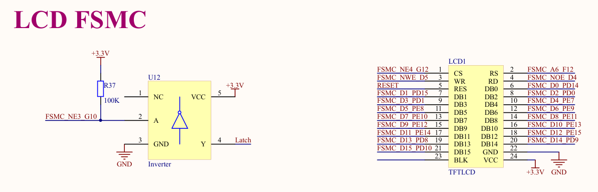
*Figure 8. 16-bit 8080 parallel FSMC bus interface for the TFT-LCD.*

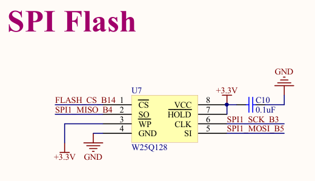
*Figure 9. W25Q128 16 MB SPI NOR Flash storage circuit.*

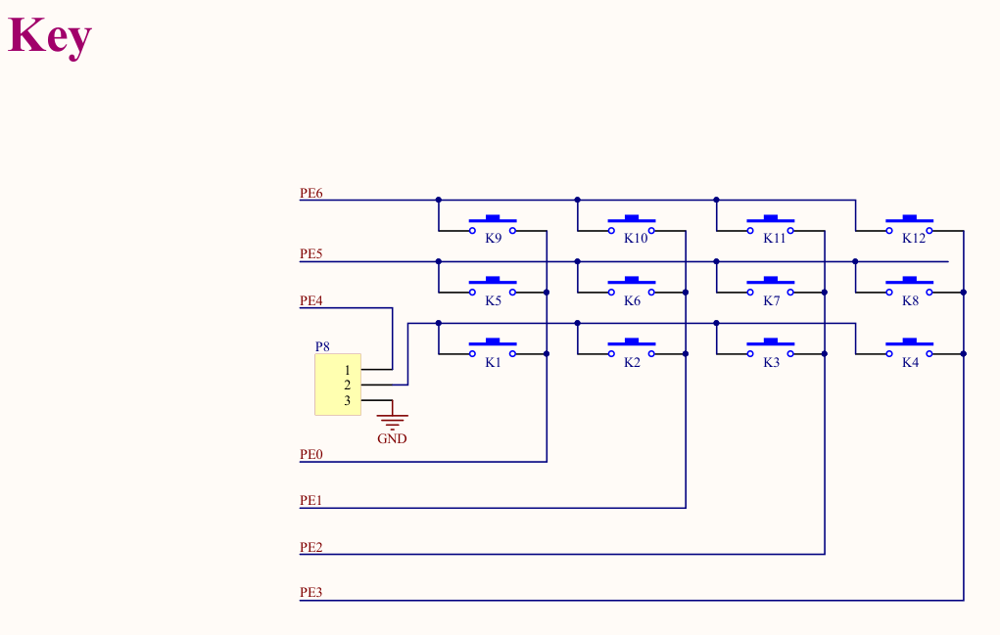
*Figure 10. Tactile push-button K1 active-low input circuit.*

---

## 2. Preemptive μC/OS-II RTOS Concurrency Architecture

To eliminate blocking delays inherent in bare-metal polling, the firmware is architected on **μC/OS-II** (`OS_TICKS_PER_SEC = 1000`, 1 ms system tick).

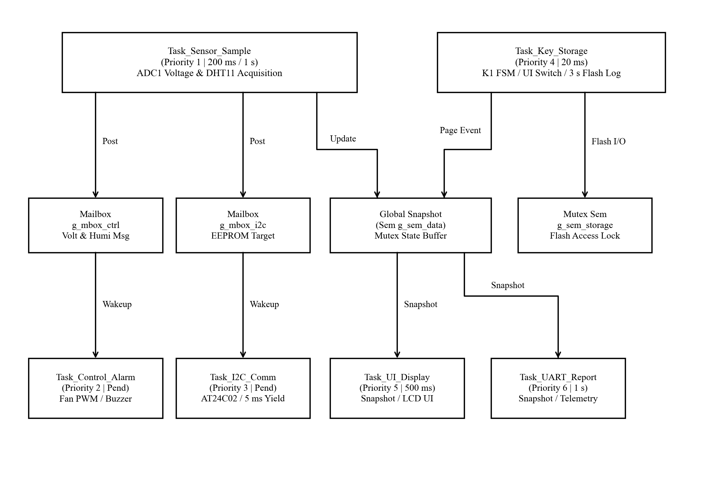
*Figure 11. Three-tier μC/OS-II preemptive task architecture and unidirectional IPC data flow.*

### Task Partitioning & Priority Matrix

The system is decomposed into one initialization task (`Task_Start`, which self-deletes via `OSTaskDel(OS_PRIO_SELF)` after spawning resources) and six orthogonal application tasks:

| Task Name | Priority | Stack Size | Scheduling / Trigger | Core Responsibility |
| :--- | :--- | :--- | :--- | :--- |
| `Task_Sensor_Sample` | 1 (Highest) | 256 words (1 KB) | Periodic (`200 ms`) | Samples `ADC1` voltage and `DHT11`, posts to `g_mbox_ctrl` & `g_mbox_i2c` |
| `Task_Control_Alarm` | 2 | 256 words (1 KB) | Event-driven (`OSMboxPend`) | Unpacks voltage/humidity, computes 10 kHz PWM duty, updates alarm flags |
| `Task_I2C_Comm` | 3 | 256 words (1 KB) | Event-driven (`OSMboxPend`) | Writes parameters to `AT24C02`, yields 5 ms via `OSTimeDlyHMSM`, verifies readback |
| `Task_Key_Storage` | 4 | 256 words (1 KB) | Periodic (`20 ms`) | Executes 4-state `K1` debounce FSM and 3 s `W25Q128` circular log commits |
| `Task_UI_Display` | 5 | 512 words (2 KB) | Periodic (`500 ms`) | Acquires data snapshot, performs zero-flicker partial `FSMC` LCD refresh |
| `Task_UART_Report` | 6 | 512 words (2 KB) | Periodic (`1000 ms`) | Acquires data snapshot, formats fixed-length frame, transmits via `USART1` |
| `Task_Start` | 7 (Init) | 128 words (512 B) | One-shot at boot | Creates semaphores/mailboxes, calibrates `OSStatInit()`, spawns tasks, self-deletes |

### Synchronization & Microsecond Data Snapshots

Because `Task_UI_Display` (FSMC pixel writes) and `Task_UART_Report` (serial transmission) take milliseconds to complete, holding a mutex across an entire peripheral transaction would starve `Task_Sensor_Sample`. Instead, a **microsecond-level snapshot mechanism** (`App_GetSensorSnapshot`) copies all 7 shared state variables into a thread-local `SensorSnapshot_t` struct under the binary semaphore `g_sem_data`, releasing the lock immediately before any formatting or bus I/O begins:

```c
typedef struct {
    float   volt;          // Photoresistor voltage snapshot
    uint8_t humi;          // DHT11 relative humidity snapshot
    uint8_t temp;          // DHT11 temperature snapshot
    uint8_t eeprom_humi;   // AT24C02 verified backup snapshot
    uint8_t fan_duty;      // Current PWM duty cycle (%)
    uint8_t alarm_en;      // Voltage threshold alarm flag
    uint8_t humi_alarm_en; // Humidity threshold alarm flag
} SensorSnapshot_t;

static void App_GetSensorSnapshot(SensorSnapshot_t *snap) {
    App_LockSem(g_sem_data);
    snap->volt          = g_light_volt;
    snap->humi          = g_humidity;
    snap->temp          = g_temperature;
    snap->eeprom_humi   = g_eeprom_humi;
    snap->fan_duty      = g_fan_duty;
    snap->alarm_en      = g_alarm_en;
    snap->humi_alarm_en = g_humi_alarm_en;
    App_UnlockSem(g_sem_data);
}
```

---

## 3. Core Peripheral Subsystems & Control Logic

### 3.1 ADC Sampling & Timer-Driven 1 Hz Buzzer Alarm
Basic timer `TIM6` (APB1 = 84 MHz) is configured with `PSC = 8399` and `ARR = 4999` to generate a continuous 500 ms timebase interrupt:
$$T_{\text{TIM6}} = \frac{(\text{PSC} + 1)(\text{ARR} + 1)}{f_{\text{TIM6}}} = \frac{8400 \times 5000}{84\times 10^6} = 0.5\,\text{s} = 500\,\text{ms}$$
Rather than starting and stopping the hardware timer dynamically, `TIM6` runs continuously in the background. When `V > 1.5 V`, `AppTask_ADC_Process()` sets `g_alarm_en = 1`, causing `HAL_TIM_PeriodElapsedCallback()` to toggle `PC8` every 500 ms (synthesizing a precise 1 Hz, 50% duty intermittent alarm). Otherwise, `PC8` is forced high to cut off `Q9`.

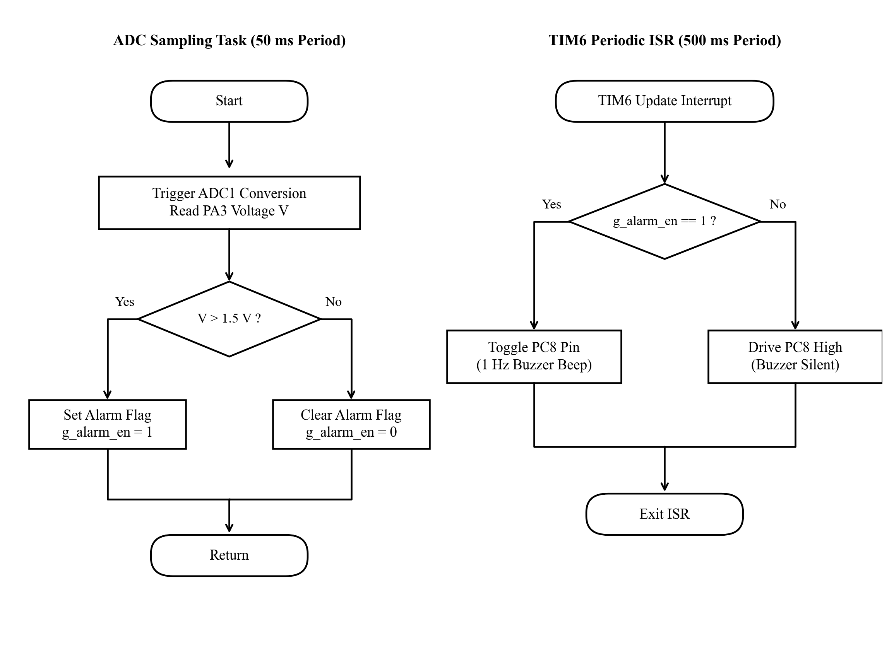
*Figure 12. Decoupled ADC threshold evaluation and TIM6 500 ms ISR alarm synthesis.*

### 3.2 TIM10 10 kHz Hardware PWM Fan Speed Regulation
General-purpose timer `TIM10` (APB2 = 168 MHz) uses `PSC = 167` (1 MHz counter clock) and `ARR = 99` to output a **10 kHz** PWM carrier—above the sensitive acoustic band to suppress motor whine. When `V > 1.5 V`, the excess voltage in $[1.5\,\text{V}, 3.3\,\text{V}]$ is linearly mapped to $0\%\text{–}100\%$ duty cycle via `CCR1`:
$$\text{Duty} = \frac{\text{CCR1}}{\text{ARR} + 1} \times 100\%$$

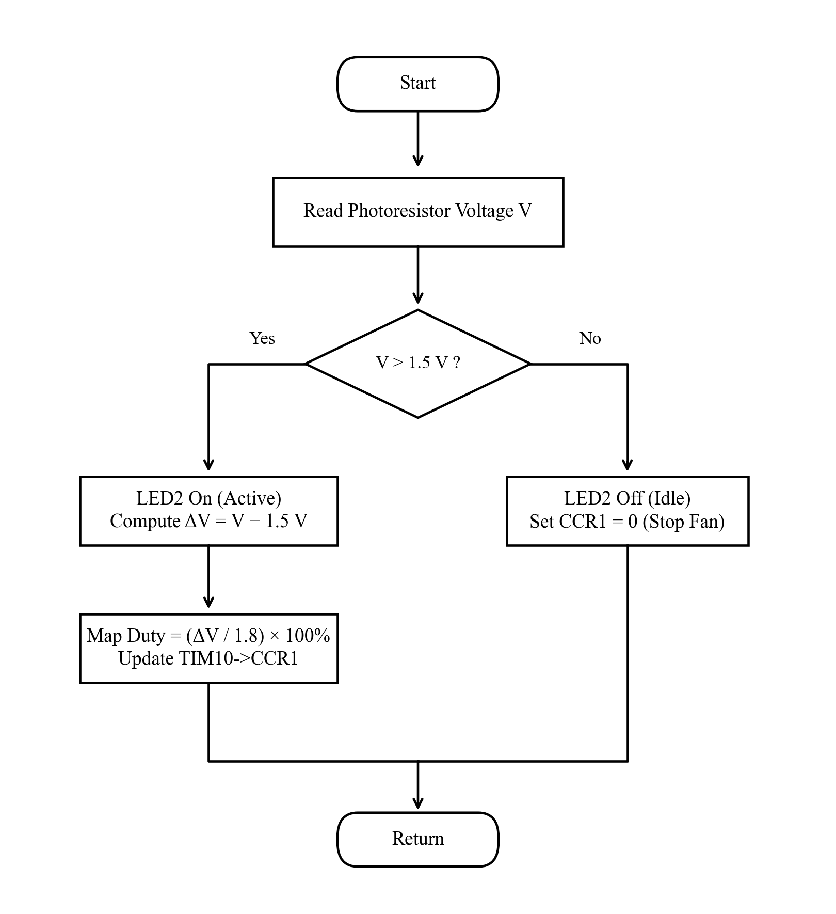
*Figure 13. Linear PWM duty-cycle mapping and fan status indicator logic.*

### 3.3 DHT11 1-Wire Acquisition & AT24C02 EEPROM Persistence
The MCU initiates DHT11 sampling with a 20 ms low pulse followed by a 30 μs release, reading 40 bits (humidity integer/decimal, temperature integer/decimal, 8-bit checksum). Global state variables are updated **only** when `DHT11_Read_Data()` returns `0` (valid checksum); failed reads preserve previous valid state. Upon receiving an update via `g_mbox_i2c`, `Task_I2C_Comm` writes to `AT24C02` and calls `OSTimeDlyHMSM(0, 0, 0, 5)` to yield the CPU during the 5 ms EEPROM internal write cycle.

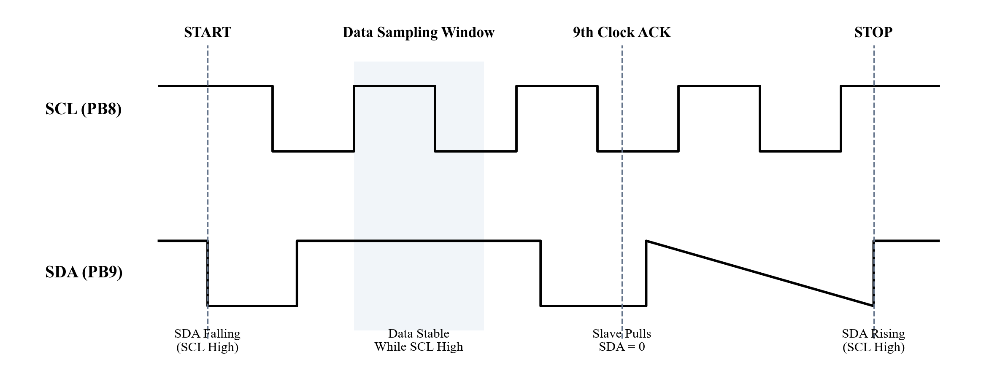
*Figure 14. Hardware I2C1 standard read/write bus timing.*

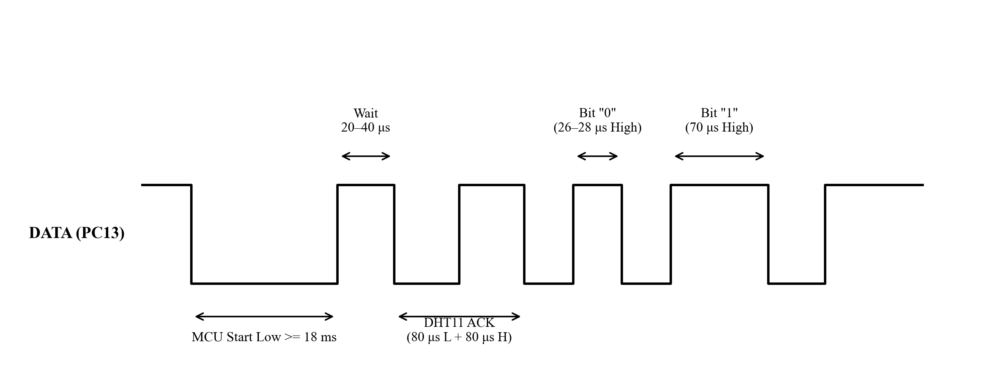
*Figure 15. DHT11 1-Wire microsecond pulse-width encoding.*

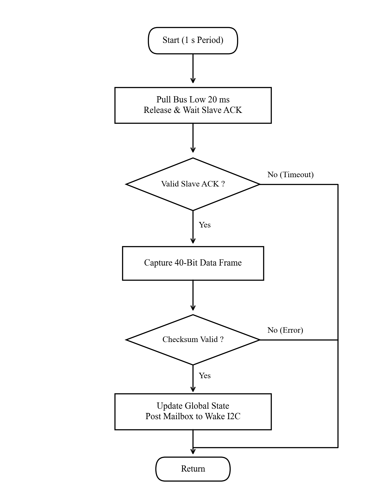
*Figure 16. Checksum-gated DHT11 acquisition and EEPROM persistence flow.*

### 3.4 FSMC TFT-LCD Dual-Page Dashboard & Zero-Flicker Refresh
Full-screen clearing (`LCD_Clear`) across $320 \times 240$ 16-bit pixels introduces tens of milliseconds of latency and noticeable flicker. To eliminate flicker, the UI engine separates **static frame rendering** from **incremental numeric updates**:
- An atomic critical section reads and clears `g_page_need_draw`.
- Static borders and labels are drawn only when switching between **Page 0 (Real-Time Dashboard)** and **Page 1 (Historical Records Table)**.
- Subsequent ticks overwrite only the changed numeric coordinates using `SensorSnapshot_t`.

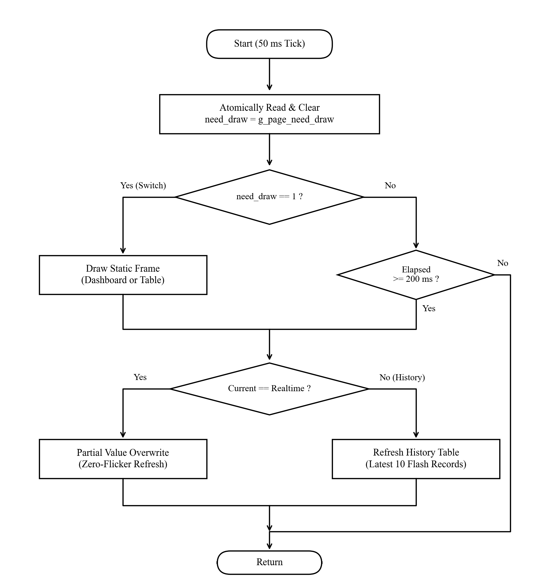
*Figure 17. Dual-page FSMC LCD state machine with zero-flicker incremental updates.*

### 3.5 W25Q128 SPI NOR Flash Ring Buffer & 4-State Key FSM
Historical telemetry records (`HistoryRecord_t`, containing voltage, humidity, temperature, fan duty, and alarm flags) are persisted at Sector 16 (`0x00010000`) of the 16 MB `W25Q128` flash using a `HistoryStorage_t` struct validated by magic word `0x55AAAA55`. Protected by `g_sem_storage`, `Storage_AddRecord()` appends up to 10 records and shifts the array as a FIFO ring buffer once full.

Tactile key `K1` (`PE0`) is polled every 20 ms by a **4-state Finite State Machine (FSM)**: `KEY_STATE_IDLE` $\rightarrow$ `KEY_PRESS_DEBOUNCE` $\rightarrow$ `KEY_STATE_PRESSED` $\rightarrow$ `KEY_RELEASE_DEBOUNCE`. Holding `K1` for $\ge 1.5\,\text{s}$ (`75 × 20 ms`) triggers `Storage_ClearHistory()`, whereas a short press toggles the active display page.

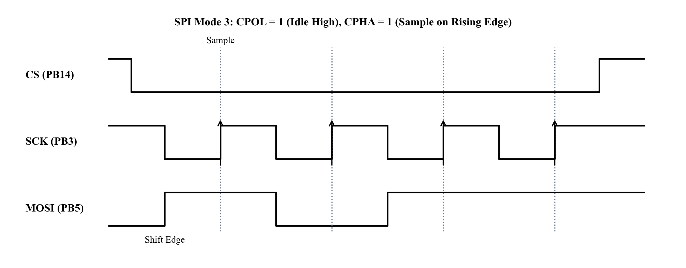
*Figure 18. SPI1 Mode 3 (CPOL=1, CPHA=1) bus timing.*

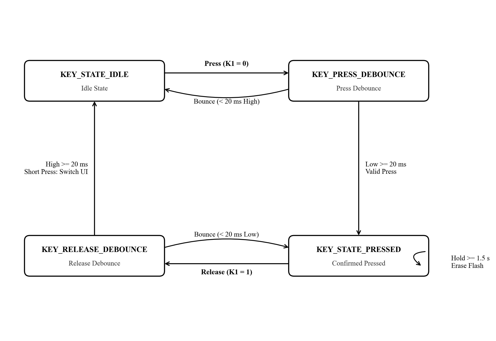
*Figure 19. 4-state software debounce FSM for short-press page switching and 1.5 s long-press flash erase.*

### 3.6 USART1 1-Second Periodic Telemetry Framing
`USART1` (`PCLK2 = 84 MHz`) operates at 115200 bps (`USARTDIV = 45.5729`, `BRR = 0x2D9`, actual baud rate 115226.3 bps, $+0.023\%$ error). Boot-time diagnostics redirect `printf()` via `fputc()` using Keil MicroLIB, while runtime telemetry (`AppTask_UART_Process`) formats fixed-length lines into a local `160`-byte stack buffer via `snprintf()` and dispatches them in a single `HAL_UART_Transmit()` call to minimize bus blocking.

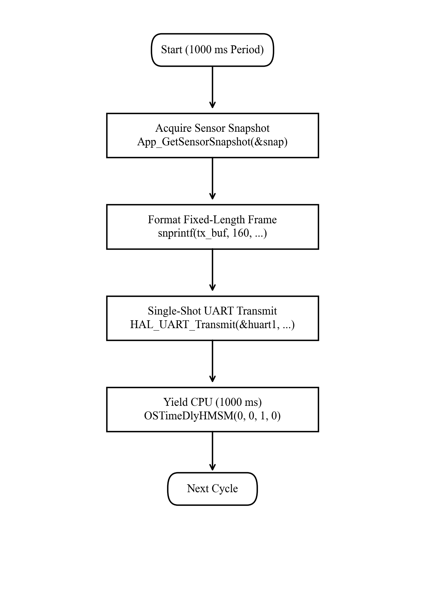
*Figure 20. Single-shot buffered USART1 1-second telemetry framing flow.*

---

## 4. Root Cause Analysis (RCA) & Embedded Debugging

Transitioning from a bare-metal prototype to a deterministic Cortex-M4F RTOS revealed four subtle hardware-software interaction bugs, resolved through disassembly inspection and logic analyzer capture:

1. **SysTick Timebase Starvation (`HAL_IncTick` vs. `OSTimeTick`)**:
   - *Symptom*: Porting `SysTick_Handler()` exclusively to `OSTimeTick()` caused `HAL_I2C_Mem_Write()` and SPI timeouts to hang indefinitely.
   - *Root Cause*: STM32 HAL timeout loops poll `uwTick`, which stops incrementing if `HAL_IncTick()` is removed from `SysTick_Handler()`.
   - *Fix*: Retained both `HAL_IncTick()` and `OSTimeTick()` inside `SysTick_Handler()`, synchronizing HAL peripheral timeouts with the 1 ms RTOS tick.

2. **HardFault from Cortex-M4F FPU & Keil MicroLIB Stack Mismatch**:
   - *Symptom*: Triggering the first `PendSV` context switch in `OSStart()` immediately jumped to `HardFault_Handler`.
   - *Root Cause*: Enabling hardware FPU alongside Keil MicroLIB skipped full FPU startup initialization, leaving `CONTROL.FPCA = 0`. Consequently, hardware exception entry omitted the 16 floating-point registers, while the μC/OS-II assembly context switcher expected a 136-byte FPU-enabled frame—creating a 64-byte `PSP` offset mismatch.
   - *Fix*: Explicitly activated the FPU context inside `OSInitHookBegin()` (`__set_FPSCR(__get_FPSCR()); __ISB();`) and enforced 8-byte alignment (`__align(8)`) on all task stack arrays.

3. **1-Wire Microsecond Timing Jitter Under Preemption**:
   - *Symptom*: `DHT11` checksum verification passed 100% on bare metal but suffered intermittent timeouts and checksum errors after RTOS migration.
   - *Root Cause*: Preemptive context switches from the 1 ms SysTick or higher-priority interrupts preempted the 27 μs / 70 μs pulse-width measurement loop.
   - *Fix*: Wrapped the 40-bit critical sampling window in `OSSchedLock()` / `OSSchedUnlock()` to guarantee uninterrupted microsecond timing.

4. **HMI Responsiveness Bottleneck from Full-Screen FSMC Redraws**:
   - *Symptom*: Early builds placed `Task_UI_Display` at high priority with full-screen `LCD_Clear()`, consuming ~40 ms per frame and causing sluggish key response.
   - *Fix*: Assigned `Task_UI_Display` to Priority 5 and refactored rendering into coordinate-specific incremental updates backed by `App_GetSensorSnapshot()`.

---

## 5. Experimental Verification & Live Results

All modules were deployed and verified on the physical STM32F407ZET6 hardware platform:

- **Photoresistor & 1 Hz Alarm**: Obscuring the sensor raised `PA3` above 1.5 V, triggering steady 500 ms on / 500 ms off buzzer oscillation; uncovering immediately silenced the buzzer.
- **10 kHz Fan PWM**: Oscilloscope probing at `PB8` confirmed a clean 10 kHz carrier with smooth $0\%\text{–}100\%$ duty-cycle tracking across $1.5\,\text{V}\text{–}3.3\,\text{V}$.
- **DHT11 & AT24C02**: Verified real-time temperature/humidity acquisition and parameter recovery across full power-off/power-on cycles.
- **TFT-LCD Dual-Screen & W25Q128**: Verified smooth short-press switching between the Real-Time Dashboard and the 10-entry Historical Table, and verified 1.5 s long-press sector erasure.
- **USART1 Telemetry**: Verified continuous 1 Hz framed logging at 115200 bps with zero dropped or garbled frames.

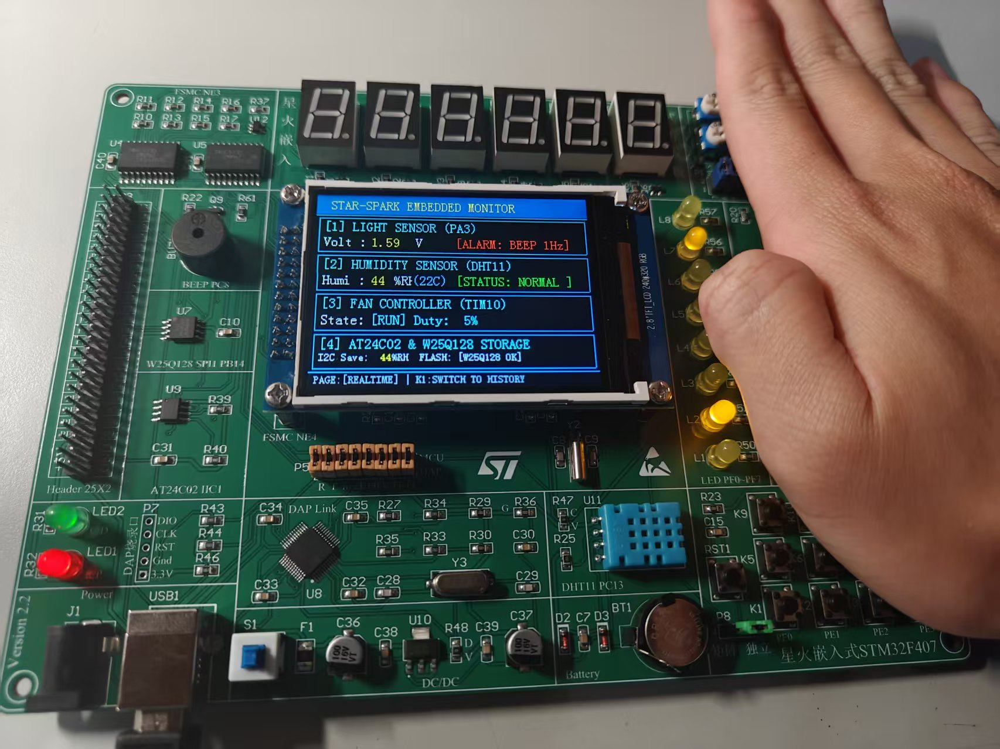
*Figure 21. Live hardware verification of photoresistor threshold detection and 1 Hz intermittent buzzer alarm.*

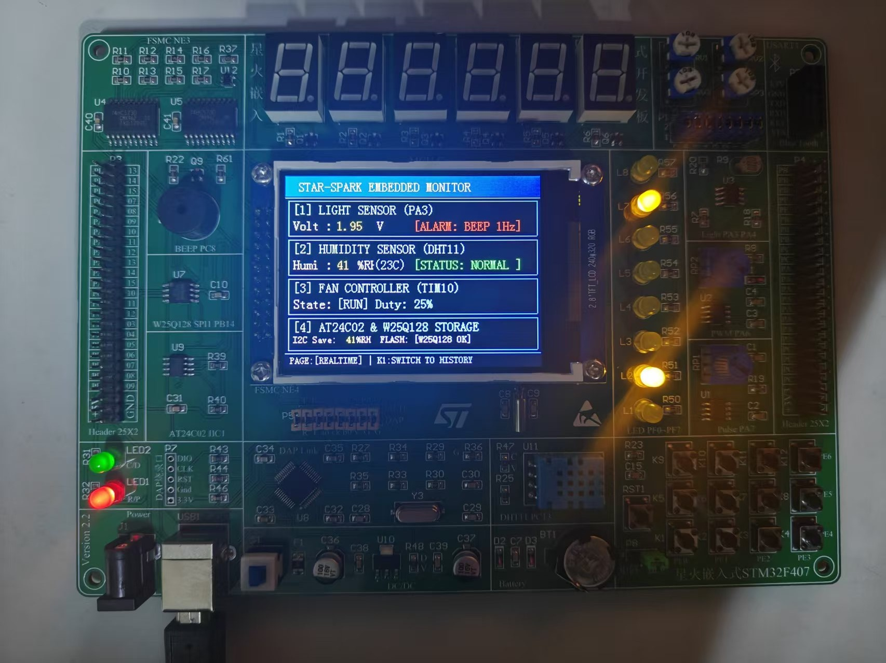
*Figure 22. DC cooling fan 10 kHz PWM stepless speed regulation and status LED feedback.*

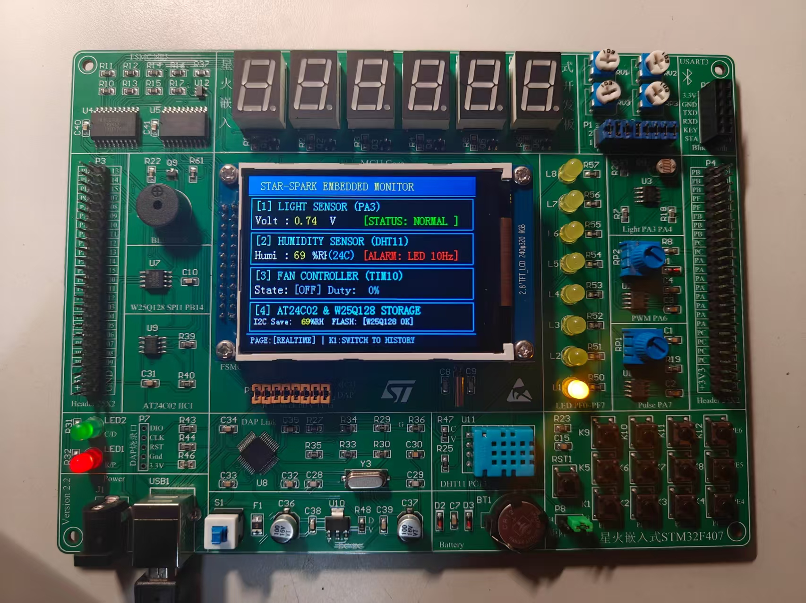
*Figure 23. DHT11 1-Wire telemetry and AT24C02 EEPROM non-volatile readback verification.*

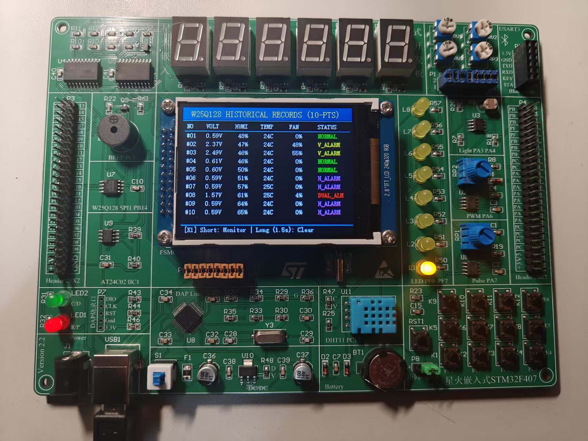
*Figure 24. FSMC TFT-LCD historical records table retrieved from W25Q128 SPI NOR Flash.*

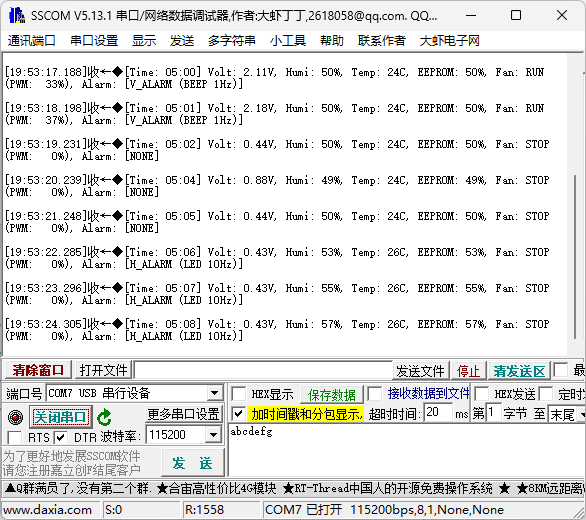
*Figure 25. Host PC serial terminal capturing 1-second periodic telemetry frames at 115200 bps.*

---

## 6. Modular Software Structure

| Module Path | Architectural Layer | Lines of Code | Core Responsibilities |
| :--- | :--- | :--- | :--- |
| `Core/Src/main.c` | Application & RTOS Tasks | 1,372 | `Task_Start`, 6 orthogonal tasks, semaphores/mailboxes, ADC, TIM6/10, Flash ring buffer, 4-state key FSM, dual-page LCD UI, UART telemetry |
| `Core/Src/dht11.c` | Sensor Driver | 225 | 1-Wire initialization, microsecond pulse decoding, 40-bit checksum verification |
| `Core/Src/at24c02.c` | EEPROM Driver | 30 | Hardware `I2C1` single-byte read/write wrappers |
| `Core/Src/flash.c` | NOR Flash Driver | 291 | `W25Q128` JEDEC ID check, 4 KB sector erase, page programming |
| `Core/Src/lcd.c` | Display Driver | 1,035 | `FSMC` 8080 initialization, pixel/line/rectangle primitives, ASCII font rendering |
| `Core/Src/stm32f4xx_it.c` | Interrupt Service | 286 | Synchronized `HAL_IncTick()` + `OSTimeTick()`, `PendSV_Handler` delegated to μC/OS-II |
| `UCOSII/port/` | RTOS Porting Layer | Port | `OS_TICKS_PER_SEC = 1000`, `OSInitHookBegin()` FPU activation, `PendSV` context switching |
